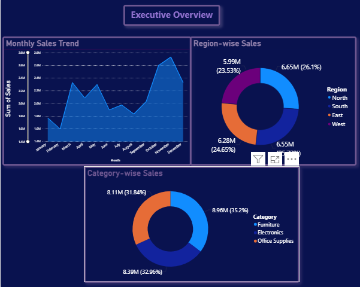
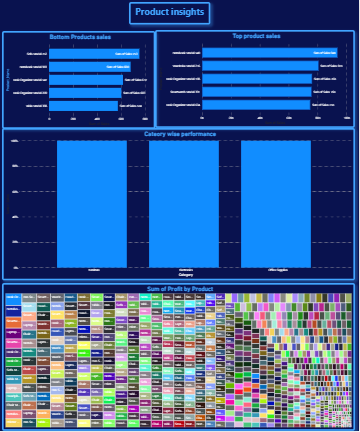
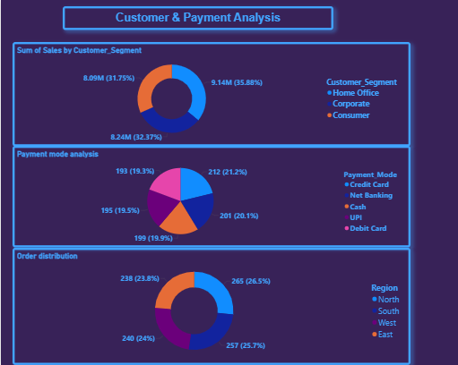

# Sales_Analytics_Dashboard

- Monthly Sales Trend: January se December tak monthly sales performance track ki hai. November mein sales sabse zyada dikh rahi hai.
- Region-wise Sales: North – 6.65M, South – 6.55M, East – 6.28M, West – 5.99M.
- Category-wise Sales:
  - Furniture: 8.96M (35.2%)
  - Electronics: 8.39M (32.96%)
  - Office Supplies: 8.11M (31.84%)
Insight: Furniture category highest sales contribute karti hai, aur North region overall sales mein lead karta hai.
An interactive Sales Analytics Dashboard developed using Microsoft Power BI to analyze sales performance, profit, products, customer segments, and regional trends.

- Customer Segments:
  - Home Office: 9.14M (35.88%)
  - Corporate: 8.24M (32.37%)
  - Consumer: 8.09M (31.75%)
- Payment Mode Analysis: Credit Card, Net Banking, Cash, UPI aur Debit Card ka distribution analyze kiya.
- Order Distribution: North – 265, South – 257, West – 240, East – 238 orders.
Insight: Home Office segment highest sales contribute karta hai. Credit Card payment ka share sabse zyada hai (21.2%).

Is page mein tumne:
- Top-performing products identify kiye.
- Bottom-performing products identify kiye.
- Category-wise performance compare ki.
- Treemap ke through product-wise profit distribution visualize kiya.
Insight: Dashboard product-level sales aur profitability ko compare karne mein help karta hai.

## Tools Used
- Microsoft Power BI
- Power Query
- DAX
- Excel / CSV

## Project Files
- Sales_Analytics.pbix
- SalesData.csv
- executive_overview.png
- Products_insights.png
- Customer_payment_analysis.png

## Dashboard Preview

